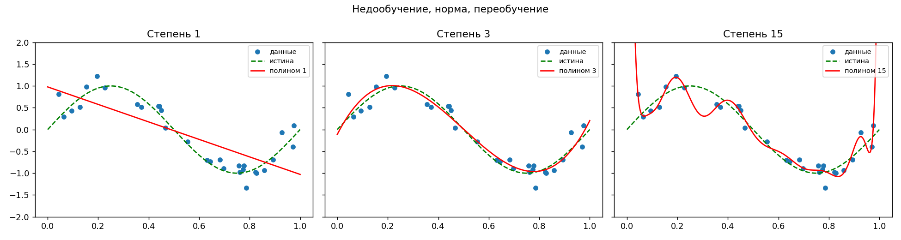
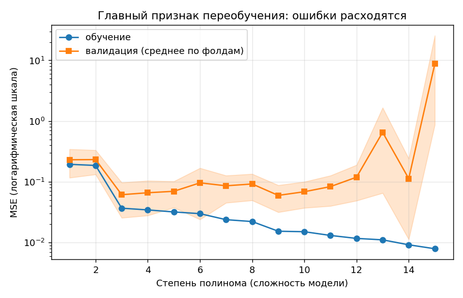
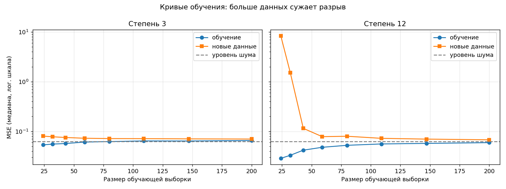
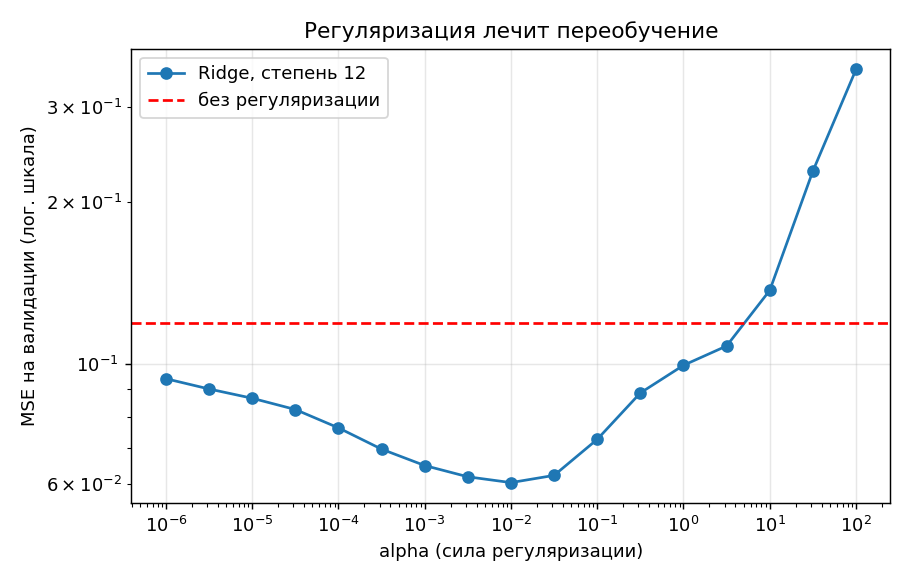
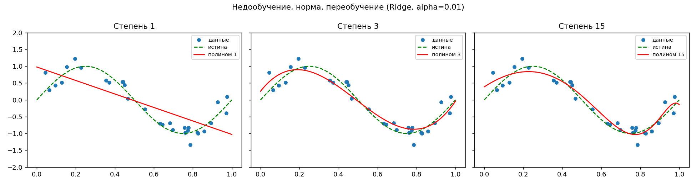

# Overfitting Lab

Учебный проект, который **наглядно показывает, что такое переобучение**, и учит с ним бороться. Программа генерирует зашумлённые данные, обучает полиномиальные модели разной сложности и сама строит четыре графика: как модель недообучается, переобучается, как помогают больше данных и регуляризация.

Всё работает из коробки: никаких внешних данных и ключей, только Python и три библиотеки.

## Содержание

- [Идея проекта](#идея-проекта)
- [Быстрый старт](#быстрый-старт)
- [Что получится на выходе](#что-получится-на-выходе)
- [Параметры командной строки](#параметры-командной-строки)
- [Эксперименты для самостоятельного запуска](#эксперименты-для-самостоятельного-запуска)
- [Как это устроено](#как-это-устроено)
- [Тесты](#тесты)
- [Частые проблемы](#частые-проблемы)
- [Идеи для развития](#идеи-для-развития)

## Идея проекта

**Переобучение** — это когда модель слишком хорошо подстроилась под обучающие данные, включая случайный шум, и поэтому плохо работает на новых данных. Ошибка на обучении при этом маленькая, а на новых данных большая.

Чтобы это увидеть, нужен случай, где мы знаем правду. Поэтому данные синтетические:

```
y = sin(2πx) + шум
```

Мы знаем истинную кривую (синусоиду) и можем честно сравнить с ней то, что выучила модель. Модели берём простейшие: полиномы степени от 1 до 15. Степень полинома здесь и есть «сложность модели»:

| Сложность | Что происходит |
|---|---|
| Степень 1 (прямая) | **Недообучение**: модель слишком проста и не ловит изгибы синусоиды |
| Степень 3 | **Норма**: достаточно гибкая, чтобы поймать закономерность, и недостаточно, чтобы запомнить шум |
| Степень 15 | **Переобучение**: проходит почти через каждую точку и «скачет» между ними |

## Быстрый старт

Нужен **Python 3.9 или новее**. Проверить: `python --version` (на macOS/Linux иногда `python3 --version`).

### 1. Скачать проект

```bash
git clone https://github.com/KorolKiraA/overfitting-lab.git
cd overfitting-lab
```

Либо скачайте ZIP с GitHub, распакуйте и откройте терминал в папке проекта.

### 2. Создать виртуальное окружение и установить зависимости

**macOS / Linux:**

```bash
python3 -m venv .venv
source .venv/bin/activate
pip install -r requirements.txt
```

**Windows (PowerShell):**

```powershell
python -m venv .venv
.venv\Scripts\Activate.ps1
pip install -r requirements.txt
```

**Windows (cmd):**

```bat
python -m venv .venv
.venv\Scripts\activate.bat
pip install -r requirements.txt
```

### 3. Запустить

```bash
python -m overfitting_lab
```

Через несколько секунд в терминале появится таблица ошибок, а в папке `results/` — четыре графика и файл `summary.json`.

### Альтернатива: установка как пакета

```bash
pip install -e .
overfitting-lab --alpha 0.01
```

После этого появляется команда `overfitting-lab`, которую можно вызывать из любой папки.

## Что получится на выходе

В папке `results/` (её можно поменять через `--out`):

| Файл | Что показывает |
|---|---|
| `fits.png` | Подгонки разной сложности поверх данных и истинной кривой |
| `error_curves.png` | Ошибка на обучении и на валидации в зависимости от степени полинома |
| `learning_curves.png` | Как ошибка зависит от размера обучающей выборки |
| `regularization.png` | Как ошибка зависит от силы регуляризации |
| `summary.json` | Параметры запуска, лучшая степень и все ошибки в числах |

Ниже результаты при параметрах по умолчанию (30 точек, шум 0.25, seed 42). Конкретные числа могут слегка отличаться на других версиях библиотек, но картина та же.

### 1. Три степени сложности



Слева прямая не может изогнуться вслед за синусоидой. По центру кубический полином почти совпадает с истиной. Справа полином 15-й степени подстроился под шум в каждой точке, а у краёв «взлетает» вверх.

### 2. Ошибка на обучении и на валидации



С ростом степени ошибка на обучении падает (в примере с 0.037 для степени 3 до 0.008 для степени 15). Ошибка на валидации сначала падает вместе с ней, а потом резко растёт (для степени 15 она около 8.7). **Расхождение этих двух линий и есть переобучение.** Оранжевая полупрозрачная полоса вокруг линии валидации — разброс ошибки между фолдами кросс-валидации.

Программа выбирает степень 3: у неё ошибка на валидации практически такая же, как у лучшей, но модель проще (см. [правило одной стандартной ошибки](#как-выбирается-лучшая-степень)).

### 3. Кривые обучения



Серая пунктирная линия — **уровень шума** (0.25² ≈ 0.0625): ниже этого значения ошибка на новых данных опуститься не может, потому что шум принципиально непредсказуем. У простой модели (степень 3) кривые идут рядом уже при небольшой выборке. У сложной (степень 12) при малой выборке разрыв огромный, а с ростом данных он сужается. Вывод: **переобучение — это отчасти нехватка данных**.

### 4. Регуляризация



Для слишком сложной модели (степень 12) мы добавляем штраф за большие коэффициенты (Ridge) и меняем его силу `alpha`. При слишком малом `alpha` модель всё ещё переобучается. При слишком большом она становится слишком простой и недообучается. Между ними есть оптимум: в примере при `alpha ≈ 0.01` ошибка падает примерно с 0.119 до 0.060, то есть вдвое, хотя степень полинома осталась той же.

Если запустить с `--alpha 0.01`, то даже полином 15-й степени ведёт себя спокойнее:



## Параметры командной строки

```bash
python -m overfitting_lab [параметры]
```

| Параметр | По умолчанию | Описание |
|---|---|---|
| `--samples` | 30 | число точек в данных |
| `--noise` | 0.25 | стандартное отклонение шума |
| `--max-degree` | 15 | максимальная степень полинома |
| `--complex-degree` | 12 | «слишком сложная» степень для кривых обучения и регуляризации |
| `--alpha` | 0 | сила Ridge-регуляризации для основных графиков (0 = выключена) |
| `--folds` | 5 | число фолдов кросс-валидации |
| `--seed` | 42 | seed генератора случайных чисел (одинаковый seed даёт одинаковый результат) |
| `--out` | `results` | папка для результатов |
| `--version` | | показать версию |
| `-h`, `--help` | | справка |

## Эксперименты для самостоятельного запуска

Лучший способ понять тему — менять параметры и смотреть, что происходит.

```bash
# 1. Мало данных: переобучение проявляется сильнее (без регуляризации ошибка степени 12 огромна)
python -m overfitting_lab --samples 15 --out results/few

# 2. Много данных: даже сложные модели ведут себя спокойно
python -m overfitting_lab --samples 200 --out results/many

# 3. Очень шумные данные: лучшая степень уменьшается (получится 1)
python -m overfitting_lab --noise 0.6 --out results/noisy

# 4. Почти без шума: можно позволить модели быть сложнее (получится 5)
python -m overfitting_lab --noise 0.05 --out results/clean

# 5. Включённая регуляризация на всех графиках
python -m overfitting_lab --alpha 0.01 --out results/ridge
```

На что смотреть: как меняется `error_curves.png` (где минимум валидации), насколько велик разрыв на `learning_curves.png` и где оптимум `alpha` на `regularization.png`.

## Как это устроено

```
overfitting-lab/
├── overfitting_lab/
│   ├── data.py      # генерация данных: sin(2πx) + шум
│   ├── models.py    # модели и три эксперимента
│   ├── plots.py     # построение графиков (matplotlib)
│   ├── cli.py       # командная строка, связывает всё вместе
│   └── __main__.py  # точка входа для python -m overfitting_lab
├── tests/           # автотесты (pytest)
├── docs/images/     # картинки для этого README
├── pyproject.toml   # описание пакета
├── requirements.txt # зависимости для запуска
└── requirements-dev.txt  # + pytest для разработки
```

### Модель

Полиномиальная регрессия собрана из трёх шагов (`sklearn.Pipeline`): `PolynomialFeatures` создаёт признаки `x, x², …, xᵈ`, `StandardScaler` приводит их к одному масштабу, затем идёт обычная линейная регрессия или Ridge, если `alpha > 0`. Масштабирование нужно, чтобы `x¹⁵` не был на много порядков меньше `x`, иначе и обучение, и регуляризация работают плохо.

### Метрика

Везде используется **MSE** (средний квадрат ошибки): чем меньше, тем лучше.

### Кросс-валидация

Данные 5 раз делятся на обучающую и проверочную части (5-fold), модель каждый раз обучается заново, а ошибка усредняется. Так оценка не зависит от того, как «повезло» с одним случайным разбиением. Это особенно важно при 30 точках.

### Как выбирается лучшая степень

Минимум ошибки на валидации может оказаться случайным: в примере степень 9 «обгоняет» степень 3 на ничтожную долю. Поэтому используется **правило одной стандартной ошибки**: берём самую простую степень, чья ошибка не хуже минимальной больше чем на одно стандартное отклонение по фолдам. Это защищает от погони за шумом и даёт более простую модель, при том что качество то же. Отключить правило можно, вызвав `best_degree(errors, one_se_rule=False)` из кода.

### Кривые обучения

Для каждого размера выборки эксперимент повторяется 30 раз на независимых данных, берётся **медиана** (она устойчива к редким катастрофическим выбросам). Проверка идёт на отдельной большой выборке из 500 точек.

## Тесты

```bash
pip install -r requirements-dev.txt
pytest
```

Тесты проверяют генерацию данных, валидацию аргументов, то, что сложная модель действительно переобучается, а регуляризация и увеличение выборки помогают, и запуск CLI целиком.

## Частые проблемы

**`python: command not found`** — на macOS/Linux используйте `python3` вместо `python`.

**`ModuleNotFoundError: No module named 'numpy'`** — не активировано виртуальное окружение или не выполнен `pip install -r requirements.txt`. Активируйте `.venv` (см. шаг 2) и повторите установку.

**PowerShell: «выполнение сценариев отключено»** — выполните один раз `Set-ExecutionPolicy -Scope CurrentUser RemoteSigned` либо используйте cmd вместо PowerShell.

**Окно с графиками не открывается** — так и задумано: графики сохраняются в PNG-файлы в папку `results/`, это работает и на серверах без экрана.

**Небольшие отличия чисел от README** — на других версиях numpy и scikit-learn значения могут отличаться в последних знаках. Форма кривых и выводы те же.

## Идеи для развития

- интерактивная версия на Streamlit со слайдерами шума, размера выборки и степени;
- Lasso (L1-регуляризация) и сравнение с Ridge;
- другие истинные функции (экспонента, ступенька, пила);
- реальный датасет (например, цены на жильё) вместо синтетического;
- кривые обучения на основе кросс-валидации вместо отдельной тестовой выборки.

## Лицензия

MIT, см. файл [LICENSE](LICENSE).
